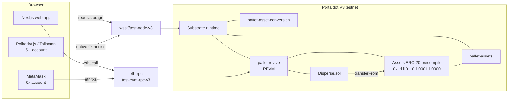

# Twofold — Architecture

## Pitch

Every token created with Portaldot's native `pallet-assets` is already an ERC-20. The runtime
exposes each asset through a precompile, so MetaMask, Solidity contracts and EVM tooling can use
it with no bridge and no wrapper contract. Nobody can find that ERC-20, though: the address
layout isn't documented, and the obvious lookup (`assetsPrecompiles.foreignAssetIdToAssetIndex`)
points at the wrong thing. Twofold makes it usable. You launch a token on the native side,
see its ERC-20 address straight away, add it to MetaMask, seed a pool on the native DEX, and pay
out to many holders from Solidity, all against the live testnet.

**Thesis:** every Portaldot token is already an ERC-20, but nobody can find it.

**What's different:** generic tools such as Polkadot.js Apps forms and the SS58↔ETH converter
show one side at a time. Twofold treats the native asset and its ERC-20 as one object, and
checks every balance from both sides.

## Problem

- **Who:** teams launching a token on Portaldot V3. The testnet already holds 16 native assets,
  including pUSD, rUSD, PORT and Portova's RUN, and 8 AssetConversion pools.
- **Today:** they create the asset through raw Polkadot.js extrinsic forms. To use it from
  MetaMask or a contract they need its precompile address, which isn't in the Portaldot docs.
  The standard Polkadot Hub prefix (`0x0120`) and index-based lookups both return empty.
- **Cost:** hypothesis, not yet confirmed with other teams. It took us about 15 minutes of
  probing and a scan of every ERC-20 `Transfer` log on chain to find the layout. Teams without
  that time skip the EVM side or deploy a duplicate ERC-20 next to their native asset, which
  splits liquidity.
- **Sponsor removal test:** take out Portaldot's native assets, the assets precompile and
  AssetConversion, and the product has nothing left to do. Every core flow is a Portaldot
  runtime call.

## Capability map

| Flow | User does | Portaldot rails |
|---|---|---|
| Launch | Name, symbol, decimals, supply → one signature | `utility.batchAll[assets.create, assets.setMetadata, assets.mint]` (native) |
| Resolve | Paste an asset id, or browse | `assets.asset` / `assets.metadata` storage → precompile `0x{id:u32}000000000000000000000000_0001_0000` → `totalSupply()`, `decimals()` over eth-rpc |
| Hold in MetaMask | "Add to MetaMask" | `wallet_watchAsset` with the precompile address; balances via `balanceOf` |
| Cross sides | Send native balance to a MetaMask address | `assets.transferKeepAlive` to the fallback account `h160 ‖ 0xEE×12` |
| Liquidity | Seed a tPOT pool | `assetConversion.createPool`, `assetConversion.addLiquidity` |
| Pay out | Upload recipients → approve → disperse | precompile `approve` → `Disperse.disperseAsset(id, to[], amounts[])` (Solidity, pallet-revive) |
| Verify | Every step | EVM receipt + native `assets.account` read must agree before the UI shows "verified" |

## System overview

## Components

- **`contracts/`** (Foundry, solc 0.8.30, deployed to pallet-revive as plain EVM bytecode)
  - `NativeAsset.sol`: asset id ↔ precompile address library, pinned to live pUSD/rUSD addresses in tests.
  - `Disperse.sol`: batch payouts of any native asset or ERC-20 from a single approval. Holds no funds.
- **`web/`** (Next.js App Router)
  - Asset directory: every native asset with its ERC-20 address, supply, decimals, pool status.
  - Asset page: both views side by side, "Add to MetaMask", holders.
  - Launch flow: native wallet signs one `batchAll`.
  - Disperse flow: MetaMask approve → disperse, with named steps and dual-side verification.
- **`scripts/`** (Node, `@polkadot/api` + viem)
  - `e2e`: launches an asset, crosses it to an EVM account, disperses through the contract, and
    checks every balance on both sides. Output saved to `docs/evidence/`.

## Data model

There's no backend database. Chain state is the source of truth.

- Native: `assets.asset(id)`, `assets.metadata(id)`, `assets.account(id, who)`, `assetConversion.pools`.
- EVM: precompile `totalSupply/decimals/balanceOf/allowance`, `Disperse.Dispersed` events.
- Address mapping: EVM `0xH` ↔ native `H ‖ 0xEE×12` (SS58 prefix 42). Native-key accounts use
  `keccak256(AccountId32)[12..]` (`autoMap: true` on this runtime).

## Key demo flows

1. **Launch → ERC-20 in under a minute:** create TWO on the native side, open it in Twofold, add
   it to MetaMask, see the same supply on both sides.
2. **Disperse:** pay 3 recipients in a native asset from Solidity, then show the native
   `assets.account` balances match `balanceOf`.
3. **Liquidity:** seed a tPOT/TWO pool so the token is tradable and (via `AssetConversionTxPayment`)
   usable for native fee payment.

## Stack choices

- **Foundry, not resolc/PolkaVM:** `allowEVMBytecode: true`, so standard solc output deploys and
  existing tooling works.
- **`@polkadot/api` for native, viem for EVM:** these are the reference clients for each side,
  and both run in the browser and in Node, so the web app and the e2e script share code.
- **No indexer:** asset count is small (16), so direct storage reads are fast enough and never stale.

## Out of scope

- Foreign (XCM) assets: the index-based precompile path. Noted, not built.
- ink!/`pallet-contracts`: only 2 contracts on chain; the EVM side is where users are.
- Mainnet, token sale or launchpad economics.
- Oracle feeds: feeder-only on this runtime.

## Milestones

- **M1 (check-in, Oct 24 12:00 UTC):** `NativeAsset` + `Disperse` tested and deployed; e2e script
  runs launch → cross → disperse → dual verify on testnet; read-only asset directory live on the web.
- **M2:** launch flow in the browser (native wallet), "Add to MetaMask", asset page with both views.
- **M3:** disperse flow in the browser with named steps and verification (done: `/payout`). Liquidity seeding is cut.
- **M4:** polish, seeded demo mode, demo video, pitch deck, final README (before Nov 5 04:00 UTC).
