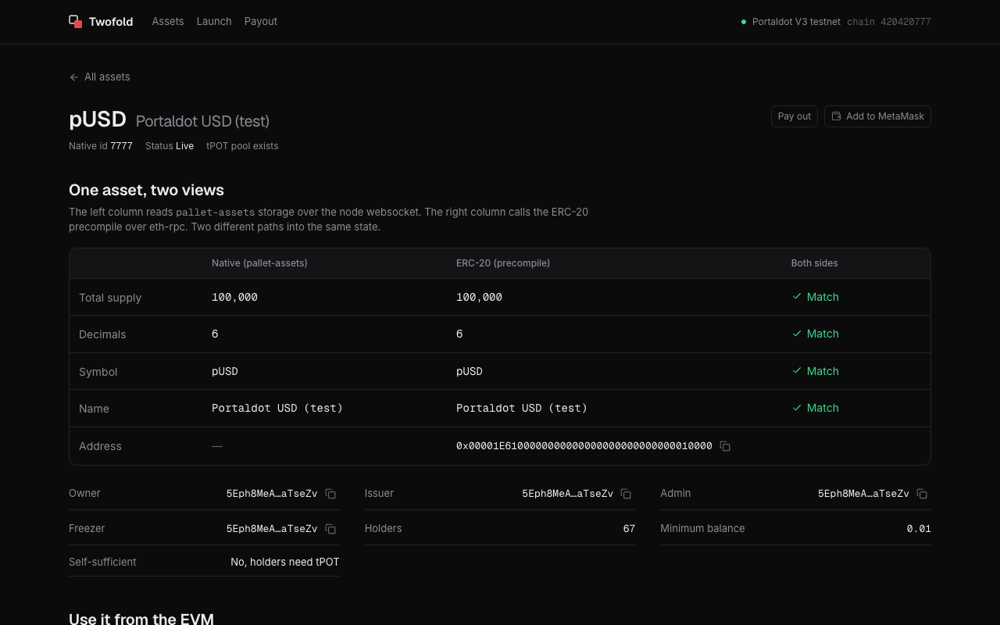
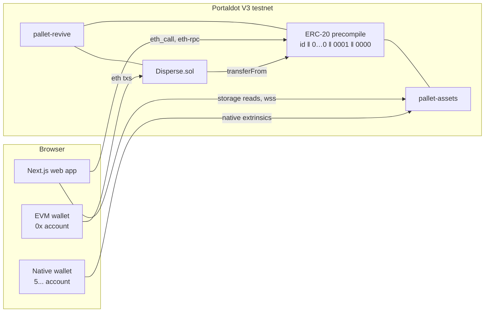
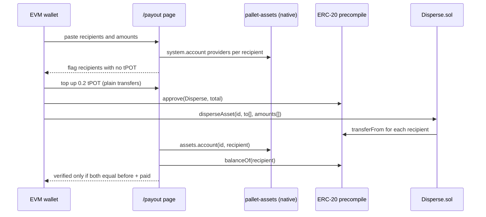

# Twofold



    

### Every Portaldot token is already an ERC-20, but nobody can find it.

Twofold is for teams launching tokens on Portaldot. You create a native asset, get its ERC-20
address straight away, hold it in an EVM wallet and pay out to many holders from Solidity, all on
the live Portaldot V3 testnet with no mocks. Every balance is checked from both the native side
and the EVM side, and the screen only says "verified" when they agree.

[**Watch the demo**](https://youtu.be/Pw0YTXZ54fk) · [**Live app**](https://twofold-tau-sooty.vercel.app) · [**Verify it yourself**](#verify-it-yourself-in-60-seconds) · [**Architecture**](ARCHITECTURE.md) · [**Run it locally**](#run-it-locally)

## Demo

[](https://youtu.be/Pw0YTXZ54fk)

2:23, narrated. It launches a new token, then pays out to three recipients with the pre-check and both-side
verification, all on the live testnet. Nothing is sped up. The wallets are scripted and sign real transactions, and the
video says so. Shot list in [docs/demo-script.md](docs/demo-script.md).

## Verify it yourself in 60 seconds

**Deployed on Portaldot V3 testnet (chain 420420777)**

| What | Value |
|---|---|
| `Disperse` contract | `0x389a5f1e3897a3cad547af7d872a174f5d22205c` |
| Deploy tx | `0x7fc579376bb429bb27163ea2cb8fe6f4108811a1f84ad227a060de5054df1123` (block 162,880) |
| Demo asset TWO (native id 20261023) | ERC-20 at `0x0135289f00000000000000000000000000010000` |
| Disperse payout tx (e2e run) | `0xb5dca03ec4f08ca0d0cd71644e4cfe38b5a28c7358b6a73e9d17f5f15bd484fe` (block 162,890) |
| Native launch extrinsic | `0xd62fdad837fd94a4ee377ae1603552d1399a6c6488b2e731d5a3876116a6300e` |
| Payout from Rabby | approve `0xedb8873a1b6db7ad09fc6f1153aad88c19c8ca60e92bf233411f7b623fa8e0d0`, payout `0x95f01798c20f8ab415143215078a618387e3ff69f2a0836f043a74f764ce674e` (block 269,675) |
| Native explorer | [node-console.portaldot.dev](https://node-console.portaldot.dev/) (there is no EVM explorer on this testnet yet) |

pUSD is native asset 7777. Its ERC-20 precompile answers directly over eth-rpc:

```sh
cast call 0x00001E6100000000000000000000000000010000 "totalSupply()(uint256)" \
  --rpc-url https://test-evm-rpc-v3.portaldot.dev
# 100000000000 [1e11]   → 100,000.000000 pUSD (6 decimals)
```

The contract is live:

```sh
cast code 0x389a5f1e3897a3cad547af7d872a174f5d22205c --rpc-url https://test-evm-rpc-v3.portaldot.dev | wc -c
# 2677   → 1,337 bytes, same as `forge build --sizes`
cast receipt 0xb5dca03ec4f08ca0d0cd71644e4cfe38b5a28c7358b6a73e9d17f5f15bd484fe status \
  --rpc-url https://test-evm-rpc-v3.portaldot.dev
# 1 (success)
```

```sh
cd contracts && forge test
# Ran 2 test suites: 10 tests passed, 0 failed
```

The full end-to-end run (launch → resolve → approve → disperse → check both sides) is in
[docs/evidence/e2e-latest.md](docs/evidence/e2e-latest.md). Reproduce it with `cd scripts && npm run e2e`.
The directory check (33 of 33 native assets have the same total supply on both sides) is in
[docs/build-log.md](docs/build-log.md).

## Contents

- [Demo](#demo)
- [The problem](#the-problem)
- [What it does](#what-it-does)
- [Architecture](#architecture)
- [The hard problem](#the-hard-problem-the-erc-20-that-wasnt-where-the-docs-said)
- [What's real vs simplified](#whats-real-vs-simplified)
- [Engineering decisions](#engineering-decisions)
- [Tech stack and project layout](#tech-stack-and-project-layout)
- [Run it locally](#run-it-locally)
- [Known limitations and disclosure](#known-limitations-and-disclosure)

## The problem

Teams on Portaldot create tokens as native `pallet-assets` assets. There are 33 on testnet
today (when we last checked), including pUSD, rUSD and PORT. The runtime already exposes each one as an ERC-20 through
a precompile, but the address layout isn't documented, and the obvious lookups return nothing.
So teams either never reach the EVM side or deploy a second ERC-20 next to their native asset
and split their liquidity.

Take out Portaldot's native assets and the assets precompile, and every flow below disappears.

## What it does

| Capability | What the user does | Portaldot calls behind it |
|---|---|---|
| Browse | Open the directory | `assets.asset`, `assets.metadata` storage, precompile `totalSupply`, `decimals` |
| Resolve | Paste an asset id | precompile `0x{id:u32}…0001 0000` → `totalSupply`, `decimals` |
| Launch | One native signature | `utility.batchAll[assets.create, setMetadata, mint]` |
| Hold in an EVM wallet | Add to MetaMask or Rabby | `wallet_watchAsset`, `balanceOf` |
| Pay out | Paste recipients → approve → disperse | precompile `approve` → `Disperse.disperseAsset` |

## Architecture

See [ARCHITECTURE.md](ARCHITECTURE.md) for components, data model and milestones.



The payout flow, which is the one that matters most:



| Contract | Role |
|---|---|
| `NativeAsset.sol` | Asset id ↔ ERC-20 precompile address |
| `Disperse.sol` | Batch payouts of any native asset from one approval; holds no funds |

## The hard problem: the ERC-20 that wasn't where the docs said

Polkadot Hub documents the assets precompile at `0x{id}…0120 0000`. On Portaldot that returns
nothing. The runtime also has an `AssetsPrecompiles` pallet that maps pUSD to index 6, which
looks like the answer and isn't. We pulled every ERC-20 `Transfer` log on chain, found two
emitters with the precompile shape, and confirmed the real layout:
**asset id in the first 4 bytes, prefix `0x0001` at bytes 16–18.** Two tests now pin the library
to live pUSD and rUSD addresses. The full trail is in [docs/build-log.md](docs/build-log.md).

## What's real vs simplified

| Capability | How it's backed | Status |
|---|---|---|
| Asset id → ERC-20 address | Live precompile calls; 33/33 testnet assets match on total supply; unit tests pinned to pUSD/rUSD | Real |
| Disperse | Deployed on pallet-revive; e2e payout to 3 recipients agreed on both sides | Real |
| Pay out in the browser | `/payout`: recipient check, tPOT top-up, approve, `disperseAsset`, dual-side verify | Real. Paid 2 recipients 1 WL each from Rabby, block 269,675, both balances agreed on both sides. Also run through a browser with a stand-in wallet, including the demo video. Not yet tried in MetaMask |
| Launch a native asset | `utility.batchAll[create, setMetadata, mint]`, from the e2e script and from the browser | Real. `/launch` was signed in SubWallet and minted 1,000,000 WL (native id 71369440), and the ERC-20 supply matched |
| Hold it in an EVM wallet | `wallet_addEthereumChain`, `wallet_watchAsset`, precompile `balanceOf` | Real. After 100 WL were sent to the account's `h160 ‖ 0xEE×12` form, Rabby showed 100 WL. Not yet tried in MetaMask |
| Asset directory web app | Reads pallet-assets and the precompile on every request | Real. Shows whether a tPOT pool exists, read only |
| Send to a 0x address | `assets.transferKeepAlive` to `h160 ‖ 0xEE×12` | Done in the e2e script and from Polkadot.js, no form in the app |
| Liquidity seeding | Cut | Not built |
| Foreign (XCM) assets | None | Not built |

## Engineering decisions

- **Foundry with plain solc, not resolc.** The runtime allows EVM bytecode, so standard tooling deploys as is.
- **Two clients, each the reference for its side.** `@polkadot/api` for native calls and storage, viem for EVM. Both run in
  the browser and in Node, so the web app and the e2e script share code.
- **No backend, no indexer.** 33 assets is small enough to read straight from chain on each request, and it is never stale.
  The runtime metadata is bundled (`web/lib/metadata.json`, refresh with `npm run metadata`) so the page doesn't download it each time.
- **Verification is part of the product.** Every flow shows named steps with the transaction hash, and the screen says
  "verified" only when the native and ERC-20 balances both equal before plus paid.
- **Gas is never hardcoded.** Weight and storage deposit are folded into gas (about 10^14), so the payout page estimates
  gas, pads it 20%, and treats a failed estimate on `disperseAsset` as a would-revert pre-flight.
- **Check recipients before sending.** A non-sufficient asset can't land on an account with no native providers, so the
  payout page flags recipients with no tPOT and can top them up with 0.2 tPOT each. The cause is plausible, not proven,
  because eth-rpc doesn't surface the revert reason.
- **Convert decimals at the edge.** tPOT has 14 decimals natively and 18 on eth-rpc.
- **Retry reads.** The public eth-rpc occasionally drops batched calls, so reads go through a short backoff.

## Tech stack and project layout

```
contracts/   Foundry: NativeAsset library, Disperse contract, tests, deploy script
scripts/     deploy, fund and e2e against the live testnet (@polkadot/api + viem)
web/         Next.js app: directory, asset page, /launch, /payout
docs/        build log, e2e evidence, demo script, submission text
```

## Run it locally

Prerequisites: Node 22, [Foundry](https://getfoundry.sh), and testnet tPOT for the issuer and deployer accounts. The web
app needs no environment variables. The scripts read `.env`:

| Variable | Required | What it is |
|---|---|---|
| `SUBSTRATE_WS`, `EVM_RPC`, `CHAIN_ID` | yes | Portaldot V3 testnet endpoints, defaults in `.env.example` |
| `ISSUER_MNEMONIC`, `ISSUER_ADDRESS` | yes | Native sr25519 account that creates assets (testnet only) |
| `DEPLOYER_PRIVATE_KEY`, `DEPLOYER_ADDRESS` | yes | EVM account that deploys Disperse and runs the payout |
| `DEPLOYER_NATIVE_ADDRESS` | yes | Native fallback account of the deployer (`h160 ‖ 0xEE×12`). Fund it with tPOT |
| `DISPERSE_ADDRESS` | after deploy | The deployed contract |

```sh
git clone --recursive git@github.com:techbone/twofold.git && cd twofold
cp .env.example .env            # fill in testnet keys; fund ISSUER_ADDRESS with ~200 tPOT
cd contracts && forge test && forge build
cd ../scripts && npm install
npm run deploy                  # funds the EVM deployer, deploys Disperse (~118 tPOT incl. storage deposit)
npm run e2e                     # writes docs/evidence/e2e-latest.md
npm run fund -- <address> 5     # send tPOT to a native or 0x address
cd ../web && npm install && npm run dev
```

Tests: `forge test` (10 passing), `cd web && npm run lint`.

## Known limitations and disclosure

Built for the Portaldot Network V3 Hacker House (DoraHacks), Modular Cloud & Middleware track.
First commit 2026-10-23. Uses Foundry's `forge-std` (MIT/Apache-2.0). The demo video uses scripted wallets
that sign real transactions with throwaway testnet keys, and says so on screen. Testnet only; not financial advice.
